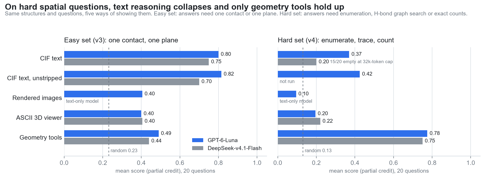
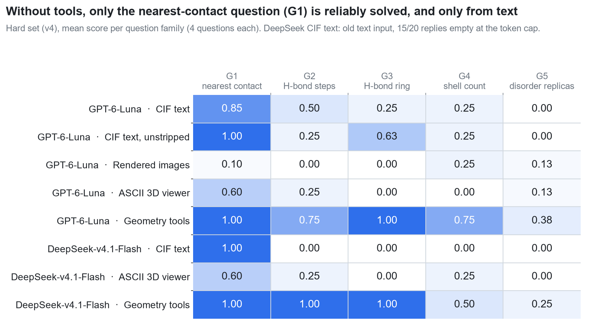

# CrystalSight

**Language models can read a crystal file, but text-only reasoning collapses on real 3D work, and the right geometry tools recover it.**

CrystalSight is a small, reproducible benchmark that asks LLM agents a crystallographer's questions and shows the *same* structure through different channels: CIF text, rendered images, an interactive ASCII 3D terminal viewer (TUI), and geometry tools (reported separately as a reference upper bound). On the hard spatial set (v4, 20 questions: symmetry copies, H-bond paths and rings, shell counts, disorder replicas), two models score 0.20–0.43 from CIF text, 0.10–0.22 from images or the viewer (random: 0.13), and 0.75–0.78 with geometry tools. On the easy set (v3), CIF text alone reaches 0.70–0.82. Ground truth is computed with [MolCrysKit](https://github.com/SchrodingersCattt/MolCrysKit) plus documented rules (v1) or directly from geometry (v3/v4); images and the TUI come from [MatterVis](https://github.com/SchrodingersCattt/MatterVis).

## Key finding (spatial question sets)

The hard set (v4, 20 questions) asks for exact enumeration and graph search in five families: G1 nearest contact (which symmetry copy of an acceptor is nearest), G2 H-bond steps (to a lattice translate), G3 H-bond ring (size of the smallest ring), G4 shell count (molecules within a radius) and G5 disorder replicas (ordered major and minor replicas). On this set, the two models (GPT-6-Luna and DeepSeek-v4.1-Flash) score:

- 0.20–0.43 from CIF text;
- 0.10–0.22 from rendered images or the interactive ASCII 3D viewer (random: 0.13);
- 0.75–0.78 with geometry tools.

On the easy set (v3), where one contact or one plane is enough, CIF text alone reaches 0.70–0.82.





| set | GPT-6-Luna cif / cif_raw / image / tui / tools | DeepSeek-v4.1-Flash cif / cif_raw / tui / tools |
|---|---|---|
| v4 hard | 0.37 / 0.43 / 0.10 / 0.20 / **0.78** | 0.20* / not run / 0.22 / **0.75** |
| v3 easy | 0.80 / 0.82 / 0.41 / 0.40 / 0.49 | 0.75 / 0.70 / 0.41 / 0.44 |

\* DeepSeek CIF on v4: 15 of 20 replies were empty because the model used its whole 32k-token output budget on reasoning. That run also predates the text-input fix described below. DeepSeek is text-only, so it has no image channel. All easy-set (v3) text results also use the old input.

Scores are rounded half up to two decimals (e.g. 0.425 → 0.43); exact values are in [`analysis/results_v4.md`](analysis/results_v4.md).

**How the spatial sets are built.** Gold answers are computed from symmetry-expanded geometry in `crystalsight/gt_spatial.py`. Atoms are named in the copy-aware form `SITE#k[i,j,k]`. Every answer is recomputed with all cutoffs shifted by ±5 %, and fragile questions were replaced. For v4, the precomputed `_geom_hbond_*` tables are removed from both text channels, because they would hand over answers. We also fixed a stripping bug that removed the `loop_` keyword from CIF tables; GPT-6-Luna's v4 text channels were re-run with the fixed input. The tools channel adds six small geometry tools built for this benchmark (`crystalsight/channels/geom_tools.py`). They return raw lists, not answers. The viewer gets an H-bond overlay, a distance query and a disorder-component switch (`crystalsight/channels/tui_extras.py`). Details are in [`DESIGN.md`](DESIGN.md), [`tasks_v4/TASKS_v4.md`](tasks_v4/TASKS_v4.md) and [`analysis/results_v4.md`](analysis/results_v4.md).

**Reproduce the spatial results without an API key.**

```bash
python scripts/make_figures_v4.py           # figures/v4_fig*.png + analysis/results_v4.{md,csv} from results/real-v3, results/real-v4
python -m crystalsight run --models mock-oracle mock-random --channels cif cif_raw image tui tools \
       --tasks tasks_v4/tasks_v4.jsonl --run-id mock-v4 --workers 4
python -m crystalsight score mock-v4 --tasks tasks_v4/tasks_v4.jsonl
```

To run the two real models on the hard set (see *Real models* below for the endpoint setup):

```bash
python -m crystalsight run --models gpt-6-luna deepseek-v4.1-flash --channels cif cif_raw image tui tools \
       --tasks tasks_v4/tasks_v4.jsonl --run-id real-v4 --max-tokens 32768 --timeout 900 --workers 8 --resume
python -m crystalsight score real-v4 --tasks tasks_v4/tasks_v4.jsonl
```

On Windows, `scripts/real_v4.ps1` does the same; the overrides are recorded in `run_meta.json`. Three v4 tasks and nine v3 tasks use licensed CSD-derived structures. These are kept locally under anonymous ids in the gitignored `data/structures/ccdc_local/` and are not distributed, so those tasks need your own CSD licence to rerun. All other tasks use public COD structures and the non-CSD MolCrysKit examples shipped under `data/structures/mck/` (see `data/structures/README.md`). CSD-derived MolCrysKit example CIFs are not redistributed.

## Structure-check set (v1, 247 questions)

The original set below asks structure-check questions and was run with two different models (DeepSeek-v4-Flash and Gemini-2.5-Flash). It found the same ordering, with CIF text above images and the viewer.

* Design and rules: [`DESIGN.md`](DESIGN.md)
* One-page write-up (spatial sets): [`writeup/CrystalSight_onepager.pdf`](writeup/CrystalSight_onepager.pdf) (source: `.md`); the v1 write-up is `writeup/CrystalSight_onepager_v1.pdf`
* Results: spatial sets [`analysis/results_v4.md`](analysis/results_v4.md); v1 [`analysis/results.md`](analysis/results.md), [`analysis/results.csv`](analysis/results.csv), figures in [`figures/`](figures/)

## Question families

| id | question | answer |
|----|----------|--------|
| Q3 | Are hydrogens missing? On which elements? | `{missing_h, elements}` |
| Q4 | Is there disorder? Which components, which type? | `{disordered, components, types}` |
| Q6 | Coordination number and geometry of the metal | `{cn, geometry}` |
| Q7 | Is the structure usable for simulation as is? Which issues? | `{usable, issues}` |
| Q8 | Which of two structures has property X (A / B / both / neither)? | choice |

Scoring gives partial credit per field (see `crystalsight/score.py`). The released task set has 247 questions over structures from the Crystallography Open Database (COD) and redistributable (non-CSD) MolCrysKit examples. Some task IDs still name CSD-derived structures that are not shipped; those need a local CSD licence (see `data/structures/README.md`).

## Channels

| channel | what the model sees |
|---------|---------------------|
| `cif` | CIF text with publication metadata and answer-revealing hints removed |
| `cif_raw` | unmodified CIF text (leakage control) |
| `image` | three rendered views (six for pairs) |
| `tui` | an interactive MatterVis terminal viewer, 8 actions per structure (rotate, zoom, change display, ...) |
| `tools` | MolCrysKit analysis tools (*reference upper bound, not part of the main leaderboard*) |

## Install

Python 3.11+ is required.

```bash
python -m venv .venv
# Windows: .venv\Scripts\activate    Linux/macOS: source .venv/bin/activate
pip install -e .
python -m pytest -q tests        # optional sanity check
```

`pip install -e .` pulls MolCrysKit and MatterVis (from GitHub main) as dependencies.

## Quick start with mock models (no API key)

```bash
python -m crystalsight taskgen                  # GT + tasks -> data/gt/, tasks/tasks.jsonl (already shipped)
python -m crystalsight prepare                  # renders + TUI warm-up cache -> data/renders/
python -m crystalsight run --models mock-oracle mock-random --channels cif cif_raw image tui tools --run-id mock-e2e --workers 8
python -m crystalsight score mock-e2e
python -m crystalsight report mock-e2e --cases 5  # -> reports/mock-e2e/index.html
```

`mock-oracle` answers with the gold label (pipeline check, should score 1.0); `mock-random` is the random baseline used in the analysis.

## Real models (your own OpenAI-compatible endpoint)

Credentials are read **only** from environment variables or from a repo-local `.env` (gitignored). Copy the template and fill it in:

```bash
cp .env.example .env
# OPENAI_BASE_URL=https://your-gateway.example.com/v1
# OPENAI_API_KEY=...
# optional separate endpoint for the DeepSeek entry: DEEPSEEK_BASE_URL / DEEPSEEK_API_KEY
```

Model entries live in [`configs/models.toml`](configs/models.toml) (only variable *names*, never values). Each entry has a generic default `model` id; if your gateway names the model differently (e.g. with a provider prefix), set the variable named in its `model_env` field, e.g. `CRYSTALSIGHT_MODEL_DEEPSEEK=<your-id>` in `.env`, instead of editing the file. Set `vision = false` for text-only models (the image channel is then skipped). Then:

Spatial sets (v3/v4), models `gpt-6-luna` and `deepseek-v4.1-flash`:

```bash
python -m crystalsight smoke --models gpt-6-luna deepseek-v4.1-flash
python -m crystalsight run --models gpt-6-luna deepseek-v4.1-flash --channels cif cif_raw image tui tools --tasks tasks_v4/tasks_v4.jsonl --run-id real-v4 --max-tokens 32768 --timeout 900 --workers 8 --resume
```

The v1 set (247 questions) was reported with `deepseek-v4-flash` and `gemini-2.5-flash`:

```bash
python -m crystalsight smoke --models deepseek-v4-flash gemini-2.5-flash       # one request per model/channel
python -m crystalsight run --models deepseek-v4-flash gemini-2.5-flash --channels cif image tui tools --run-id real-full --workers 16 --resume
python -m crystalsight run --models deepseek-v4-flash gemini-2.5-flash --channels cif_raw --run-id real-full --workers 16 --resume
python -m crystalsight score real-full
python -m crystalsight report real-full --cases 5
```

On Windows, `scripts/real_full.ps1` does both passes plus scoring (`--resume` makes it restartable). Use `--structures id1 id2 ...` for a subset. API keys are never written to `runs/` or `reports/`.

## Reproduce analysis and figures

```bash
python scripts/analyze.py --run real-full --random-run mock-e2e   # -> analysis/results.{md,csv,json}, detection.csv, failure_cases.json
python scripts/make_figures.py --run real-full                    # -> figures/fig1_leaderboard.png, fig2_families.png, fig3_example.png
```

`analysis/` and `figures/` in the repository were produced from the run reported in the write-up (2026-10-22). Full raw run records (`runs/`, with complete model transcripts) are not committed. Instead `results/real-full/` holds the scored answers (`scored.jsonl`, `summary.json`, `leaderboard.csv`) and the TUI frames used in Figure 3, and `results/mock-e2e/scored.jsonl` holds the random baseline. Both scripts read `runs/<run>` if it exists and otherwise fall back to `results/<run>`, so the analysis and figures can be reproduced from a fresh clone without API access.

## Data and licensing

The v1 task set uses COD structures (public domain / CC0) and redistributable non-CSD MolCrysKit examples only. Several MolCrysKit example CIFs are CSD/CCDC downloads and were removed from this repository (copyright); see `data/structures/README.md`. Three v4 tasks and nine v3 tasks additionally use licensed CSD-derived structures kept only under gitignored `data/structures/ccdc_local/`. `scripts/fetch_data.py` re-downloads COD files and the safe MolCrysKit subset.

## Repository layout

```
crystalsight/        runner, channels (cif_text, image, tui, tools), models, gt, taskgen, score, report
configs/models.toml  model registry (env-var names only)
data/                structures (CIF), ground truth (data/gt), manifest
tasks/tasks.jsonl    the 247 v1 questions with gold answers and evidence
tasks_v3/, tasks_v4/ spatial question sets (easy, hard) with gold, robustness checks and TUI feasibility notes
scripts/             fetch_data, analyze, make_figures, real-run helpers
results/             scored answers of the reported runs (real-full = v1, real-v3, real-v4; mock baselines)
analysis/, figures/  results of the reported run
writeup/             one-page summary
```
