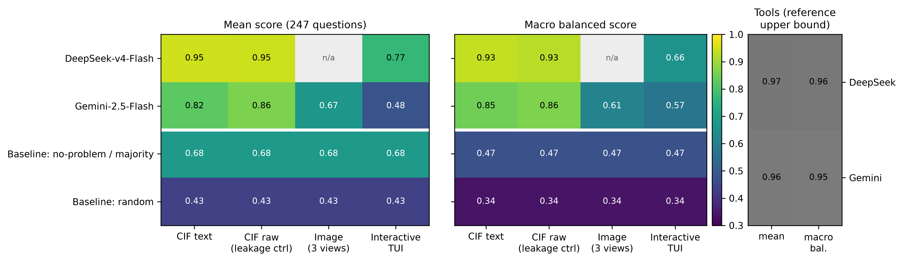

**Motivation.** Before a crystal structure from a database is used for simulation or design, a crystallographer checks it: are hydrogens missing, is part of it disordered, what is the metal's coordination, is it usable as is? LLM agents are increasingly asked to do this, and they can be given the structure as CIF text, as rendered pictures, or as an interactive viewer. We do not know whether these representations are equivalent.

**Research question.** For the same structure and the same question, how does an LLM's judgement depend on the representation (CIF text, static images, interactive terminal viewer), and how does it compare with trivial baselines and with tool access?

**Benchmark design.** Five question families a crystallographer asks: **Q3** missing hydrogens (and on which elements), **Q4** disorder (components, alternative positions vs partial occupancy), **Q6** metal coordination number and geometry, **Q7** usability for simulation (issues: disorder / missing H / solvent), **Q8** pairwise comparison (A / B / both / neither). 247 questions over 67 structures from the Crystallography Open Database plus MolCrysKit examples. Ground truth is computed with **MolCrysKit** (molecule splitting, occupancies and disorder groups, hydrogen completion, bond records, continuous-shape-measure polyhedron fit) followed by documented rules (e.g. H counted missing if completion adds more than 5 % of the hydrogen atoms; CShM ≤ 3 for Q6; Q7 issues = disorder ∪ missing H ∪ solvent). Every gold answer carries its evidence. Channels: **cif** (CIF text with give-away disorder/occupancy annotations stripped), **cif_raw** (unstripped, leakage control), **image** (3 MatterVis renders), **tui** (an interactive MatterVis ASCII viewer, 8 actions: rotate, zoom, display level, labels). A **tools** channel (MolCrysKit analysis calls) is reported only as a reference upper bound. Field-level partial credit; **balanced** score = mean of problem and clean subsets per family, macro-averaged. Models: DeepSeek-v4-Flash (text only) and Gemini-2.5-Flash (vision), via an OpenAI-compatible gateway, temperature 0.

**Results.** CIF text is by far the strongest representation: DeepSeek 0.950 mean / 0.934 macro balanced, Gemini 0.823 / 0.849. Visual channels fall towards the baselines: Gemini image 0.669 / 0.612, DeepSeek TUI 0.767 / 0.658, Gemini TUI 0.481 / 0.571. A trivial "no problem / majority" answer scores **0.678 mean** (0.474 balanced) and random 0.435 / 0.336, so on the raw mean Gemini's image and TUI runs do *not* beat answering "everything is fine". Tools reach 0.968 / 0.963 (DeepSeek) and 0.958 / 0.955 (Gemini). Leakage control: unstripped CIFs change DeepSeek by −0.004 and Gemini by +0.039 mean (Q3 +0.17), so the stripping matters little for the main ranking.

**Key findings.** (1) *Representation dominates model choice:* the same model differs by 0.24–0.28 macro-balanced points between CIF text and pictures/viewer. (2) *Visual channels fail asymmetrically:* on disorder, DeepSeek-TUI has sensitivity 0.25 / specificity 1.00 (it almost always says "ordered"), Gemini-TUI 0.94 / 0.27 (it flags almost everything); on the problem subset DeepSeek-TUI scores 0.334, below random (0.345). (3) *Coordination from pictures is unreliable:* image and TUI reach 0.64 on Q6 versus 0.91–1.00 from text, e.g. a 7-coordinate Fe (pentagonal bipyramid) is read as octahedral by every visual run while both text runs are correct. (4) *Imbalance hides failure:* because most structures are clean, plain accuracy rewards "no problem"; balanced scores and trivial baselines are needed to read such benchmarks.

**Limitations.** Ground-truth thresholds are heuristic (H completion, alternative-position distance, CShM cut-off); tools reach only 0.87–0.89 on Q4, pointing at ambiguity in the disorder component/type rules. Classes are imbalanced (52 problem items of 201 in Q3/Q4/Q7) and Q6 has only 11 questions. 67 structures, 2 models, a single run each. COD only: the pipeline also runs on CSD entries locally, but those cannot be redistributed. Renders may not visually encode partial occupancy at all, which partly explains Q4 failures in the image channel.

**Future work.** More structures and models with repeated runs and confidence intervals; occupancy-aware renders and TUI display modes; an opt-in local CSD task builder; expert review of the ambiguous gold labels; agent strategies that combine viewing with text or tool checks.

*Code, tasks, ground truth and figures are released with the repository; see README for reproduction.*
